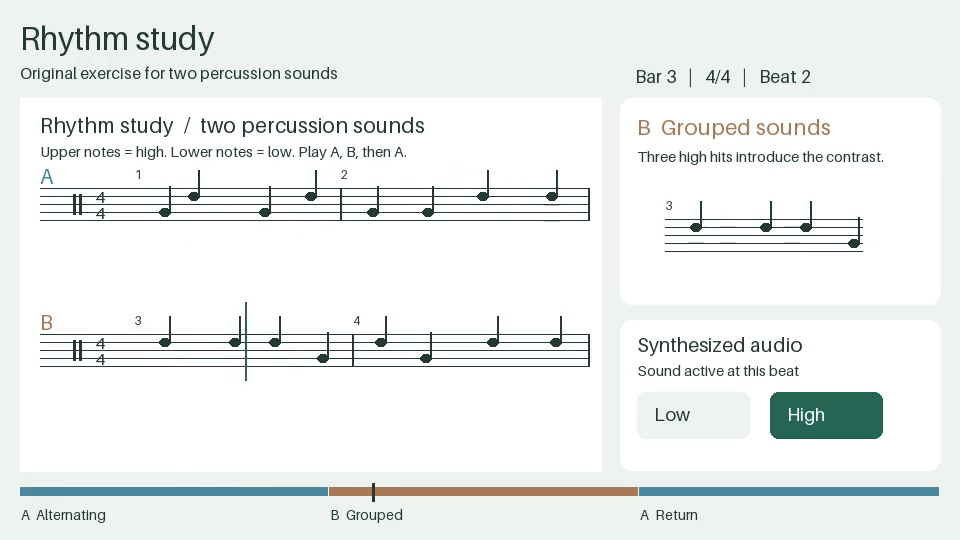

# Score Video Guide

Score Video Guide is a Codex skill and a set of tools for building synchronized classical score videos. It covers source identification, score and form analysis, time mapping, layout, conducting animation, encoding, and delivery checks. The two exercises below run from this checkout without access to a previous chat or private project.



## Run the first exercise

Install Python 3.10 or later and [FFmpeg with libx264](https://ffmpeg.org/download.html). Make sure `ffmpeg` and `ffprobe` are on your PATH. Both exercises use Pillow. A fresh checkout needs these commands.

```sh
git clone https://github.com/von-Karasheep/score-video-guide.git
cd score-video-guide
python3 -m venv .venv
source .venv/bin/activate
python -m pip install 'Pillow>=10.1'
python -B examples/rhythm_study.py
```

Open `rhythm-study-output/rhythm-study.mov`. The program writes the original training score, synthesized source audio, alignment, chapter TXT, a frame from the encoded video, and a QA report beside it. Follow the [walkthrough](examples/README.md) to inspect each result and transfer the method to a real performance.

## Two worked exercises

| Exercise | What you reproduce |
| --- | --- |
| [Original rhythm study](examples/README.md#1-build-a-score-following-video) | A complete 26.8 s teaching video at 960 × 540, with 24 timed attacks, a return to the first staff system, an A–B–A chapter sheet, and a decoded PCM comparison. |
| [Beethoven Ninth conducting excerpt](examples/README.md#2-replay-a-real-conducting-excerpt) | The Op. 60 style card from an archived Berlin performance. Inspect two strokes with different durations, check the bundled assets, and optionally rerender the 45-frame excerpt with the original font files. |

## Use the skill on a real performance

For Codex, place the checkout at `~/.codex/skills/score-video-guide` or link it there, then invoke `$score-video-guide`. Run the following from the checkout if that skill path is available.

```sh
mkdir -p ~/.codex/skills
ln -s "$PWD" ~/.codex/skills/score-video-guide
```

Start with a recording or local media file, the score edition or a way to identify it, the movement, and the output you want. For example, ask for a single representative passage first and give the local score and media paths. Include an explicit decision on the preview or full-movement export.

| Stage | Save | Read |
| --- | --- | --- |
| Identify inputs | Recording, audio, score edition, pages, hashes, and the played repeats | [Sources and research](references/sources-and-research.md) |
| Map score to sound | Score positions, played occurrences, timing evidence, and uncertainty | [Synchronization workbook](references/sync-workbook.md) |
| Compose and encode | Score placement, analysis and motif crops, same-performance inset, cues, encode settings, and renderer | [Layout and rendering](references/layout-and-render.md) |
| Verify and deliver | Decoded audio and images, source/edition credits, engineering index, and work-level chapter TXT | [Final output contract](references/final-output-contract.md) |

A full production uses the chosen performance media, score, licensed fonts and a project renderer. Keep these inputs and the exact commands with the engineering record. The standard deliverable is 3840 × 2160 at 30 fps. The rhythm study uses a smaller, fixed canvas for a quick local run. For a Beethoven project, use the [series profile](references/beethoven-series.md) and the [approved layout data](assets/beethoven-layout.json). See [SKILL.md](SKILL.md) for the full workflow.
